## プリンタの調整・設定ガイド(ZDシリーズ) USB編

</br>

<!--
_backgroundColor: black
_color: white
-->


UPDATE: 2026/10/10


### ◆ 目次

- [プリンタの調整・設定ガイド(ZDシリーズ) USB編](#プリンタの調整設定ガイドzdシリーズ-usb編)
  - [◆ 目次](#-目次)
  - [◆ 準備](#-準備)
  - [◆ 設定ファイルの取得](#-設定ファイルの取得)
    - [「参考」 設定ファイルの構成](#参考-設定ファイルの構成)
  - [◆ ラベルタイプの確認](#-ラベルタイプの確認)
  - [◆ 設定用USBメモリの作成](#-設定用usbメモリの作成)
  - [◆ 印字圧力の調整　　](#-印字圧力の調整)
  - [◆ サプライの装填（リボン）](#-サプライの装填リボン)
  - [◆ サプライの装填（ラベル）](#-サプライの装填ラベル)
  - [◆ ラベルセンサーの調整（重要）](#-ラベルセンサーの調整重要)
    - [補足：ギャップセンサー位置](#補足ギャップセンサー位置)
  - [◆ プリンタに設定を反映](#-プリンタに設定を反映)
  - [◆ 設定の確認(プリンタ)](#-設定の確認プリンタ)
  - [◆ 設定の確認(プリンタ)](#-設定の確認プリンタ-1)
  - [◆ 印刷品質の最終調整](#-印刷品質の最終調整)
  - [◆ その他の設定（通信、用紙オプション）](#-その他の設定通信用紙オプション)
  - [◆　トラブルシューティング/QA](#トラブルシューティングqa)

</br>

---
### ◆ 準備

本手順で必要なマテリアルは下記の通り。

|マテリアル|詳細|
|-|-|
| プリンタ| Zebra プリンタ ZDシリーズ　<br/> Link-OS 7.7以上推奨
| ラベル   | - ロール型、または、ファンフォールド
| インクリボン | - 1.0" または 0.5"コアのリボン </br> - **巻き取り用の紙芯** ※１
| USBメモリ | Type A コネクタ
| USB ケーブル | USB-A <--> USB-B ※１
| Windows PC   |下記ソフトウェアがインストール済みであること。</br>- [Zebra Setup Utilities for Windows](https://www.zebra.com/us/en/support-downloads/software/printer-software/zebra-nucleus-connector.html)</br>- [Zebra Designer 3 Professional](https://www.zebra.com/jp/ja/support-downloads/software/printer-software/zebra-designer-3-downloads.html)
| 清掃キット | [クリーニングキット](https://github.com/shimauma-giken/Zebra-Printer_Genuine-Cleaning-Kits)

</br>

**※１ プリンタに同梱されている**
**※２ 清掃キットについては[リンク](https://github.com/shimauma-giken/Zebra-Printer_Genuine-Cleaning-Kits)を参照**

</br>

**推奨マテリアル**

|マテリアル|詳細|備考|
|-|-|-|
|シリアル接続ケーブル| PC環境に応じて準備| トラブルシューティング、複数台導入で重宝する

</br>

---
### ◆ 設定ファイルの取得
**Windows パソコンの作業。**

1. 設定用ファイルを[ダウンロード](https://github.com/shimauma-giken/Zebra-Printer-ZT-Series-Easy-Pinter-Configurator-with-USB)する。
   [ <>Code ] > [ Download ZIP ]
   <br/>
   
2. ZIPを解凍する。
</br>

#### 「参考」 設定ファイルの構成

   | ファイル名    | 用途 |
   |-|-|
   | DEL_STAMP.ZPL	| USBメモリタイムスタンプ削除用	| 
   | PRT_TEST.ZPL	| 印刷テスト用（印刷のみ）	| 
   | RFID_RO1.zpl	| 印刷テスト用（RFID Read）	| 
   | RFID_RW1.ZPL	| 印刷テスト用（RFID Write）	| 
   | SET_CALB.ZPL	| 設定用（用紙キャリブレーション）	| 
   | SET_DTBR.ZPL	| 設定用（感熱、黒マーク）	| 
   | SET_DTGP.ZPL	| 設定用（感熱、ギャップ）	| 
   | SET_TTBR.ZPL	| 設定用（熱転写、黒マーク）	| 
   | SET_TTGP.ZPL	| 設定用（熱転写、ギャップ）	| 

</br>
</br>

---
### ◆ ラベルタイプの確認

|Media Type| Image|
|-|-|
|**連続紙・レシート**|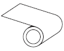|
|**ギャップ・ノッチ**|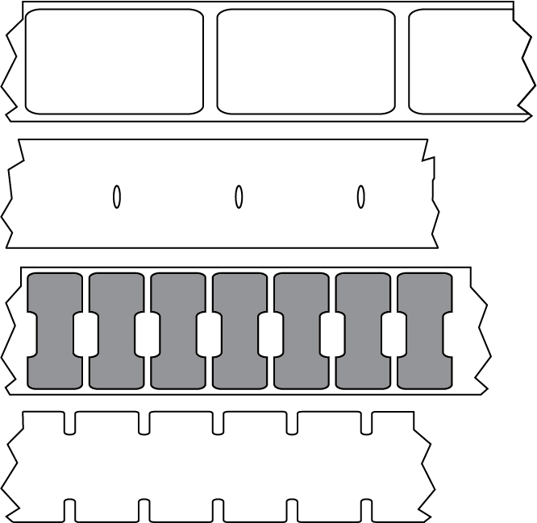|
|**黒マーク**|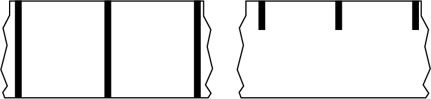|

   </br>
   </br>

---
### ◆ 設定用USBメモリの作成

**Windows パソコンの作業。**

1. USBメモリをFat32でフォーマットする。
2. USBメモリのフォルダ構成の下記の通りにする。

   ```
   [USBドライブ]:
   \ZEBRA
      ├─appl
      ├─commands
      ├─files
      └─feedback
   ```

   |フォルダ名|役割|
   |-|-|
   |appl    |ファームウェア自動更新用|
   |commands|設定ファイル用|
   |files   |ファイル転送用|
   |feedback|フィードバック用|

   <br/>

3. 先にダウンロードしたファイルから、利用するラベルに合ったSETファイルを選択する。
   
   | ファイル名    | 用途 |
   |-|-|
   | SET_DTBR.ZPL	| 設定用（感熱、黒マーク）	| 
   | SET_DTGP.ZPL	| 設定用（感熱、ギャップ）	| 
   | SET_TTBR.ZPL	| 設定用（熱転写、黒マーク）	| 
   | SET_TTGP.ZPL	| 設定用（熱転写、ギャップ）	| 

   ```
   例：　感熱・黒マークの場合は"SET_DTBR.ZPL"
   ```
   <br/>

4. 選択したSETファイルをcommandsフォルダ下にコピーする。

   ```
   [USBドライブ]:
   E:\ZEBRA
   ├─appl
   ├─commands
   │      SET_*****.ZPL ★
   │
   ├─files
   └─feedback   
   ```
   <br/>

5. 先にダウンロードしたFeedback.getファイルをfeedbackフォルダにコピーする。

   ```
   E:\ZEBRA
   ├─appl
   ├─commands
   │      SET_DTBR.ZPL
   │
   ├─files
   │      Feedback.get ★
   │
   └─feedback
   ```
   <br/>

6. 先にダウンロードした３つのファイルをルートにコピーします。
   ```
   E:.
   │  DEL_STAMP.ZPL ★
   │  PRT_TEST.ZPL  ★
   │  SET_CALB.ZPL  ★
   │
   └─Zebra
      ├─appl
      ├─commands
      │      SET_DTBR.ZPL
      │
      ├─files
      │      Feedback.get
      │
      └─feedback
   ```
   <br/>
7. Windows PCからUSBメモリを抜きます。

<br/><br/>

---
### ◆ 印字圧力の調整　　
**プリンタの作業。**

ZDシリーズは実施不要。

</br>
</br>

---
### ◆ サプライの装填（リボン）
**プリンタの作業。** 

**※ 感熱印刷の場合は不要な手順**

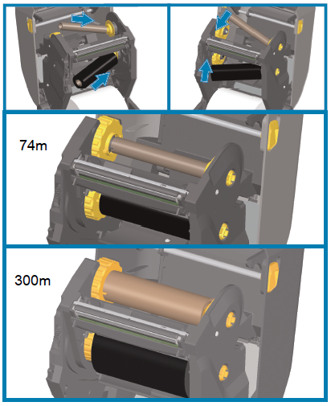 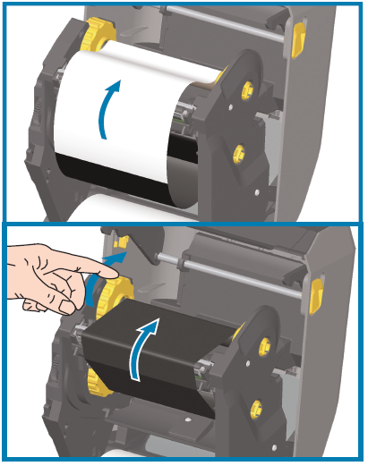
</br>

下記点に注意しながら、リボンを装填する。
- インク面に注意
- リボンの取り付け方向
- リボンの通り道（PHDの下を通るように）
  
詳細な手順はユーザーズガイドを参考にすること。  
[熱転写ロール リボンの装着](https://docs.zebra.com/jp/ja/printers/desktop/zd421-and-zd621-desktop-printers-user-guide/c-zd620-420-setup/c-zd200t-ug-loading-thermal-transfer-roll-ribbon.html)

</br></br>

---
### ◆ サプライの装填（ラベル）
**プリンタの作業。**

</br>

1. 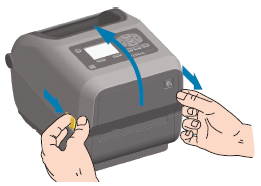 カバーを開く
2. 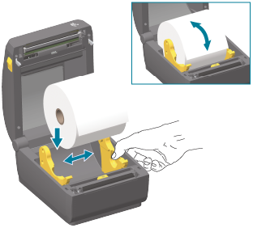 メディア幅の調整とロード
3. 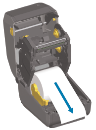 メディアをドローする 
4. 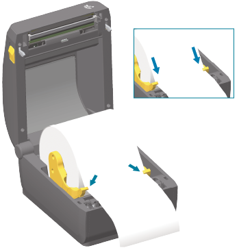 メディアをガイドに通す
</br>

※ 詳細は下記リンクを参照  
[用紙のセット](https://docs.zebra.com/jp/ja/printers/desktop/zd421-and-zd621-desktop-printers-user-guide/c-zd620-420-setup/guid-293b74c5-3de0-4bc1-8ae9-8118915c5e31-ja/t-zd620-420-loading-media.html)

</br></br>


---
### ◆ ラベルセンサーの調整（重要）
**プリンタの作業。**

ラベルセンサーをラベル形状、タイプに合わせて、ポジショニングすること。
<br>

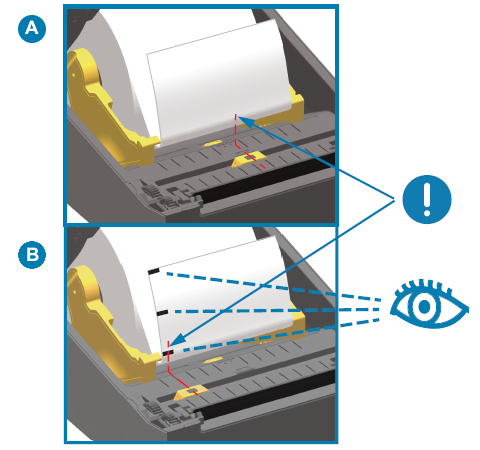 

|図| ラベルタイプ| センサ位置|
|-|-|-|
|A| ギャップ   |・センサー位置をギャップ位置に合わせる。</br>・**受光センサー範囲内**に設定すること。
|B| 黒マーク   |・センサー位置をブラックマーク位置に合わせる。

<br>

#### 補足：ギャップセンサー位置
ラベル間が最も狭くなる位置が望ましい。
   


</br></br>


---
### ◆ プリンタに設定を反映
**プリンタの作業。**

1. 作成したUSBメモリをプリンタ背面のUSBポートに挿す。
   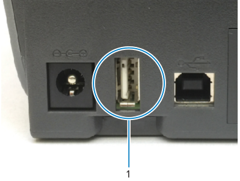

2. プリンタにてミラー処理（自動更新処理）が開始される。プリンタが1－2回再起動するので待つ。（所要時間：MAX数分程度）

---
### ◆ 設定の確認(プリンタ)
**プリンタの作業。**

**設定が適切に反映されているか確認する。**

1. プリンタのフィードボタンを押下し、ラベルが1枚ずつ出力されることを確認する。

1. テスト印刷をする。
   フロントパネルがあるプリンタはフロントパネルで確認可能。<br/>
   ```
   [メニュー] > [フォルダアイコン] > [USB] > [印刷：USBから] > [prt_test.zplを選択して、チェックボタンを押下]
   ```

---
### ◆ 設定の確認(プリンタ)
**Windows パソコンの作業。**

1. USBをプリンタから抜いて、PCに挿します。
1. feedbackフォルダ内のファイルをテキストエディタで開き、設定内容を確認。

   ```
   E:.
   │  DEL_STAMP.ZPL
   │  PRT_TEST.ZPL
   │  SET_CALB.ZPL
   │
   └─Zebra
      ├─appl
      ├─commands
      │      SET_DTBR.ZPL
      │
      ├─files
      │      Feedback.get
      │
      └─feedback
               DBJ233203930.txt ★ "シリアル番号".txt
   ```
   <br/><br/>

   **feedbackファイル例**
   ```
   ###########################################
   Zebra Technologies
   Feed back.get Results 2022/02/18 Updated
   Autor: Zebra Senior Sales Engineer
   ###########################################


   # General
   ---------------------
   Type		= ZD621R
   SKU		= ZD6A143-30PFR2EZ
   Firmware	= V93.21.53Z
   Serial number	= DBJ233203930


   # Bluetooth
   ---------------------
   Version		= 7.5
   Date		= 04/28/2026
   Friendly name	= ZD621R-DBJ233203930
   Min security	= 3
   Discoverable	= off
   Radio ver	= 5.2
   Enable		= on
   Connected	= no
   Long Address	= 60:95:32:0D:37:E6
   Short Address	= 6095320D37E6


   # Networks
   ---------------------
   DHCP		= on
   DHCP Server	= 0.0.0.0
   IP Address	= 0.0.0.0
   Netmask		= 0.0.0.0
   Gateway		= 0.0.0.0
   Port		= 6101
   ★ DHCP設定の場合はNW設定が取得できないことがあります。


   # Mirror
   ---------------------
   Server		= 127.0.0.1
   Home Dir	= Zebra
   Appl Dir	= 
   Feedback Dir	= Zebra/feedback
   Mode		= ftp
   Success	Date	= Oct 10 2026 19:10:09
   Error Msg	= No Error


   # Ntp/RTC
   ---------------------
   Ntp Enabled	= on
   Ntp Server	= ntp.nict.jp
   RTC Time	= 19:10:14
   RTC Date	= 10-10-2026
   RTC Timezone	= UTC-09
   RTC Exists	= yes


   # Display
   ---------------------
   Language	= japanese


   # Media Settings
   ---------------------
   Printmode	= tear off
   Media Type = mark
   Thermal mode	= DT
   Sense mode	= bar
   Speed		= 6.0
   Darkness	= 10.0
   Width		= 1280
   Max length	= 10


   # Printer Actions
   ---------------------
   Media power up	= no motion
   Media head close= feed


   # RFID Settings
   ---------------------
   rfid.reader_1.power.read	= 16
   rfid.reader_1.power.write	= 16
   rfid.position.program		= F0
   rfid.reader_1.antenna_port	= A1


   # Syslog
   ---------------------
   Enable		= on
   Config		= DEBUG,LOCAL
   Local file	= yes


   # ZBI
   ---------------------
   Enable		= on
   State		= off
   key		= DISABLED 
   Running Program	= 


   # Virtual Devices
   ---------------------
   apl.
   apl.enable : none , Choices: apl-d,apl-i,pdf,none
   apl.framework_version : 2.1 
   apl.version : none 
   apl.installed_versions : apl-d:2.0,apl-i:2.0,pdf:2.06,, 
   apl.settings :  
   apl.o.
   apl.o.graphics_byte_width : 160 , Choices: 0-255
   apl.d.
   apl.d.legacy : on , Choices: on,off
   apl.i.
   apl.i.crop_to_length : off , Choices: on,off


   # Maintenance
   ---------------------
   Label length/odo= 743 INCHES, 1888 CENTIMETERS
   Print length/odo= 0

   # Nucleus
   ---------------------
   weblink.logging.max_entries = 500
   weblink.ip.conn1.location   = https://savanna-device.zpc.zebra.com/weblink/connect?r=6a11f55dc2d01d0a49a7f8f8e757799b

   # weblink.logging.entries
   ---------------------
   [10-10-2026 19:10:11.905][Info][00001002][Weblink] Starting Weblink for Connection 1
   [10-10-2026 19:10:11.913][Info][00001006][conn1.1] Waiting for an IP (Main Connection) ...


   # Stored Files
   ---------------------
   - DIR *:*.* 
   * E:FEEDBACK.GET      2882          
   * E:SYSLOG.TXT        95          
   ... 略
   -   7569408 bytes free R: RAM 
   -  64524288 bytes free E: ONBOARD FLASH 

   ```
---
### ◆ 印刷品質の最終調整
**Windows パソコンの作業。**

**※ Zebra Setup Utilitiesなどを用いて設定ください**。

印刷対象のラベルに応じて、適切な設定をする。

- 印字濃度
- 印字速度
- ラベル用紙の種類 など
</br>
※ フロントパネルがあるプリンタはフロントパネルで設定可能。
</br>
</br>

---
### ◆ その他の設定（通信、用紙オプション）
**Windows パソコンの作業。**

**※ Zebra Setup Utilitiesなどを用いて設定ください**。

その他、付属オプションに応じて、適切な設定をすること。

1. 用紙オプション設定
   - カッター
   - ピーラー
   - リワインダー
2. 通信オプション設定
   - Ethernet
   - Bluetooth 
   - Wi-Fi
3. フォントファイルのインストール
   - 日本語フォントなど
4. RFID設定
   - RFID Auto Calibration

</br>
</br>


---
### ◆　トラブルシューティング/QA

> **Q.** USBメモリを指してもプリンタで更新処理が開始されない。

**A.** 下記をお試しください。
   1. Windows PCのエクスプローラからFat32でUSBメモリをフォーマットする。
   2. [SD Card Formatter](https://www.sdcard.org/ja/downloads-2/formatter-2/)を用いて、USBメモリをフォーマットする。 
   3. [プリンタを工場出荷状態に戻し](https://github.com/shimauma-giken/Zebra-Printer_Factory-Reset-Link-OS-Printer)、USBメモリを挿す。
   4. "DEL_STAMP.ZPL"を実行して、プリンタ内のタイムスタンプを削除してください。（プリンタは一度実行した履歴のある設定ファイルは無視する仕様となっているため）
<br/>

> **Q.** 独自の設定を追加したい。

**A.** USBメモリのcommandフォルダ内に設定ファイルを追加ください。
   ```
   例、
   E:.
   │  DEL_STAMP.ZPL
   │  PRT_TEST.ZPL
   │  SET_CALB.ZPL
   │
   └─Zebra
      ├─appl
      ├─commands
      │      SET_DTBR.ZPL
      │      SET_NW_RT.txt ★ NW設定を追加
      │
      ├─files
      │      Feedback.get
      │
      └─feedback
               DBJ233203930.txt
   ```
<br/>

> **Q.** フィードバックで取得する内容は変更できるか。

**A.** feedbackフォルダに保存されるファイル名とファイル内容は任意で変更可能です。詳細は["ZPL2プログラミングガイド"](https://docs.zebra.com/us/en/printers/software/zpl-pg/c-zpl-mirror-mirror/c-zpl-mirror-configuration/c-zpl-mirror-example-feedbackget-file.html)を参照ください。

> **Q.** 不足の事態が発生したため、プリンタの設定を確認したい。

**A.** [Printer Setup Utility for Windows にてAllcvを取得](https://github.com/shimauma-giken/Zebra-Printer-How-to-Retrieve-Entire-Printer-Report--Allcv-)ください。


